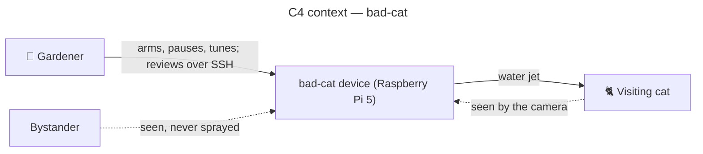

# bad-cat — architecture overview

bad-cat detects a cat near the plants with a Raspberry Pi camera and scares it away with a short
water jet, without ever spraying a person.

## Context

- **Origin**: sibling of [bad-bird](https://github.com/StudioB22/bad-bird) (pigeons) in StudioB22's
  garden defence line; architecture modelled on
  [aristech](https://github.com/benoit-bremaud/aristech) (Asian hornet deterrent).
- **Framing**: brainstorm and owner decisions of 2026-10-28, issue
  [#1](https://github.com/StudioB22/bad-cat/issues/1).
- **Method**: needs first ([requirements](specs/cat-detection-requirements.md)), then UML
  (`diagrams/cat-detection/`), then code. Every structuring choice is an MCDA-backed ADR
  ([decisions/](decisions/)).



## Stakeholders

| Role | Who | Interest |
| --- | --- | --- |
| Gardener and maintainers | Benoît Bremaud, Clément (`yazii`) | Plants protected, device left unattended, work split per issue |
| Bystanders | Neighbours, passers-by | Never sprayed, never filmed beyond the garden |
| Cat | Any visiting cat | Scared away, never harmed |

## Goals (v1)

1. Detect a cat in the protected zone in daylight.
2. Fire an adaptive water jet that makes it leave.
3. Never fire when a person is in view; abstain when unsure.
4. Let the operator check, after the fact, that it works and spot false positives.

## Scope v1

| In | Out (later) |
| --- | --- |
| Daylight detection, one fixed nozzle | Night (NoIR + IR LEDs), multi-zone valves, pan/tilt aiming |
| Pre-trained RF-DETR Nano (COCO `cat`, `person`) | Fine-tuning on own images |
| Pressurised garden sprayer + 12 V solenoid valve + timer relay | Mains water, pump |
| Mains power | Solar + battery, Pi Zero 2 W |
| Local structured log, cat crops on the device, heartbeat | LAN review page (UC3), remote push (Telegram), cloud storage |

## Architecture principles

Clean Architecture with proportional layering and SOLID ([ADR-0001](decisions/0001-adopt-clean-architecture-python.md)):

```text
interface/       CLI, composition root, SIGTERM handler
infrastructure/  OpenCV camera, ONNX Runtime detector, GPIO valve, log/crop store
application/     ProtectPlantsUnattended use case, ports
domain/          decide(), is_daylight(), episode state machine, Frame, Detection, Settings (stdlib only)
```

The domain and application layers never import OpenCV, ONNX Runtime or GPIO libraries; every
hardware or model dependency sits behind a port, so the core is tested without hardware.

## Reading order

1. [specs/cat-detection-requirements.md](specs/cat-detection-requirements.md) — needs, REQ/NFR,
   constraints, risks.
2. [decisions/](decisions/) — ADR-0001 to ADR-0005.
3. [diagrams/cat-detection/](diagrams/cat-detection/) — `01-use-case`, `02-sequence-deter-cat`,
   `03-component`, `05-state-episode`, `08-deployment`.
4. [glossary.md](glossary.md) and [traceability-matrix.md](traceability-matrix.md).
