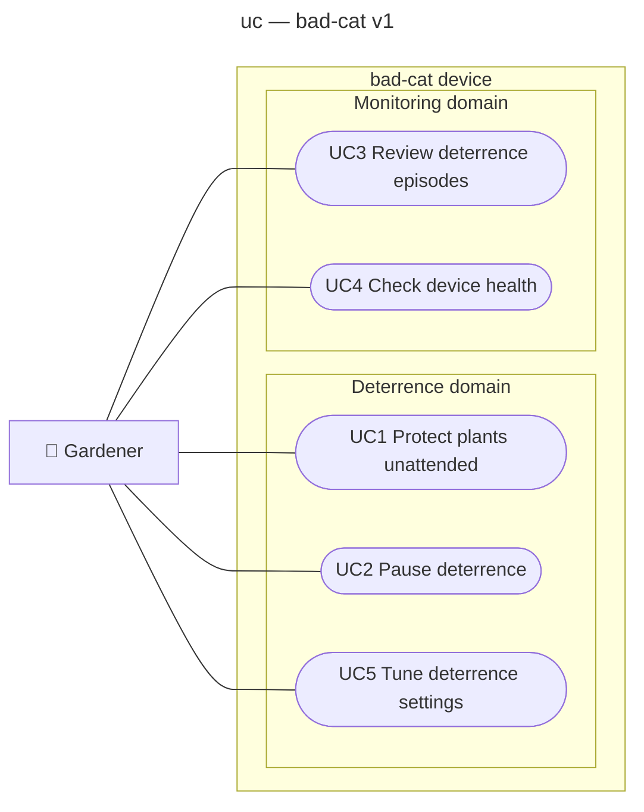

# Use case diagram — cat-detection — who wants what from bad-cat v1

The goals the gardener achieves through the bad-cat device in v1.

> **Feature**: issue #1 — [requirements](../../specs/cat-detection-requirements.md)
> **Related ADRs**: ADR-0004, ADR-0005
> **See also**: `02-sequence-deter-cat.md`, `03-component.md`, `05-state-episode.md`

## Context

It does not show how the device is built (component diagram) nor the frame-by-frame flow
(sequence diagram).

## Diagram

## Use case specifications

### UC1 — Protect plants unattended (status: planned)

- **Primary actor**: Gardener
- **Stakeholders & interests**: Bystander — never sprayed, never filmed (REQ-3, NFR-4); Visiting
  cat — scared away, never harmed.
- **Goal level**: summary (unattended, multi-day); the gardener's user-goal sitting is arming
  (step 1).
- **Preconditions**: sprayer filled and pressurised, valve wired, device powered, settings valid
  (REQ-9).
- **Assumptions**: camera aimed at the plants only, and everything the jet can reach is inside the
  camera field (set-up steps the system cannot verify).
- **Trigger**: the gardener arms the device.
- **Success guarantee**: every cat detected in the zone in daylight, with no person detected,
  receives an adaptive jet outside cooldown, and the episode is logged (REQ-1, REQ-2, REQ-4, REQ-5).
- **Minimal guarantee**: the valve never opens while a person is detected or during the hold-off
  that follows; it stays closed on any fault, stop or power loss (REQ-3, NFR-5).

**Main success scenario**

1. Gardener arms the device.
2. System holds off for one full cooldown after arming, then watches the protected zone.
3. System detects a cat at or above the cat threshold, with no person at or above the person
   threshold in the frame.
4. System fires a 1 s burst and records the episode with a crop of the cat.
5. System sees the cat absent for the absence grace (1 s), at least 5 s after the last burst, and
   starts the 60 s cooldown.
6. System resumes watching (back to step 2) until the gardener pauses it (UC2).

**Extensions**

- 2a. Light below the daylight threshold: system records `IGNORE` (dark) and does not fire until
  daylight returns (REQ-1).
- 3a. A person is in the frame: system vetoes, records `VETO` with no image (NFR-4), does not
  fire, and holds off firing for the full cooldown.
- 3b. Cat confidence below the threshold: system records `ABSTAIN`, does not fire.
- 3c. No cat in the frame: system records `IGNORE` (REQ-5).
- 5a. Cat still present after 5 s and no person in the frame: system fires again (at most 3
  bursts per episode, REQ-4), then cooldown.
- 5b. A person enters the frame during the episode: system vetoes, records `VETO`, ends the
  episode and starts the cooldown.
- *a. Camera, model, valve or recorder fails: system keeps the valve closed, writes the fault to
  stderr (journald), exits non-zero, stops the heartbeat; systemd restarts it into a full cooldown (journald shows every fault,
  UC4 a repeating one).
- *b. Gardener pauses (UC2): valve stays closed; the use case suspends until re-armed.

### UC2 to UC5 (trivial, no full spec)

| UC | Goal | Requirement |
| --- | --- | --- |
| UC2 Pause deterrence | Stop firing while gardening, without powering off | REQ-8 |
| UC3 Review deterrence episodes | See fired episodes and cat crops of the last 7 days (SSH in v1, LAN page in v2) | REQ-5, REQ-6 |
| UC4 Check device health | Know the device is alive from the heartbeat | REQ-7 |
| UC5 Tune deterrence settings | Change thresholds and jet parameters | REQ-2, REQ-4, REQ-9 |

## Notes

- Watching and firing are not use cases: they are steps of UC1, which the gardener initiates by
  arming the device.
- UC1 is a summary goal kept whole on purpose: splitting the unattended loop into ovals would turn
  system steps into fake use cases.
- The bystander and the visiting cat are stakeholders, not actors: they neither use nor serve
  the device; the cat only receives the jet.
- Refilling the sprayer is a physical chore outside the subject; the shot count in UC3 tells the
  gardener when it is due.
