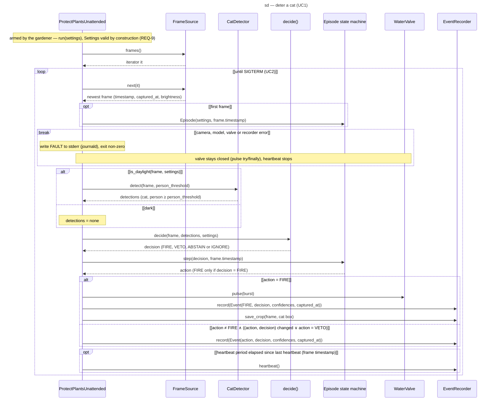

# Sequence diagram — cat-detection — deter a cat (UC1 main loop)

What happens for each frame once the gardener has armed the device: daylight check, detection,
decision, burst and recording.

> **Feature**: issue #1 — [requirements](../../specs/cat-detection-requirements.md)
> **Related ADRs**: ADR-0002, ADR-0004, ADR-0005
> **Realises**: UC1 (`SEQ-deter-cat`) · **See also**: `01-use-case.md`, `03-component.md`,
> `05-state-episode.md`

## Context

Episode timings (re-check, burst limit, absence grace, cooldown) live in the episode state machine
(`05-state-episode.md`); this diagram shows only how the components exchange messages.

## Diagram

## Notes

- Safety invariant shown by the two replies: `Episode.step` never upgrades a decision; it returns
  `FIRE` only when `decide()` returned `FIRE` for that frame, which implies no person at or above
  `person_threshold` (ADR-0004).
- `decide()` holds the daylight rule (via the pure domain function `is_daylight`) and returns
  `IGNORE` with reason `dark` when it fails; detection is skipped on dark frames to save CPU.
- `pulse(burst)` blocks the loop for the burst (1 s): no frame is read during a burst, and the
  camera adapter keeps a one-frame buffer so the next frame is always the newest.
- `save_crop` runs only in the `FIRE` branch, so no frame with a person is ever stored (NFR-4).
- `ProtectPlantsUnattended` keeps the last `(action, decision)` and records only on a change, plus
  every `FIRE` and `VETO` (REQ-5); the recorder writes what it is given. Every `Event` carries the
  confidences and `captured_at`, so a `VETO` line keeps the person confidence.
- The `break` exits the loop on any fault (UC1 ext. *a): the fault goes to stderr, not to the
  recorder that may have failed; the process exits non-zero and systemd restarts it
  (`Restart=on-failure`). The valve stays closed and no heartbeat is written meanwhile. journald shows every fault; UC4 sees only a fault that
  keeps repeating, as a heartbeat gap. SIGTERM (service stop) is handled so `try/finally`
  runs even mid-burst.
- `pulse` and recorder calls return `None`; their replies are omitted.
