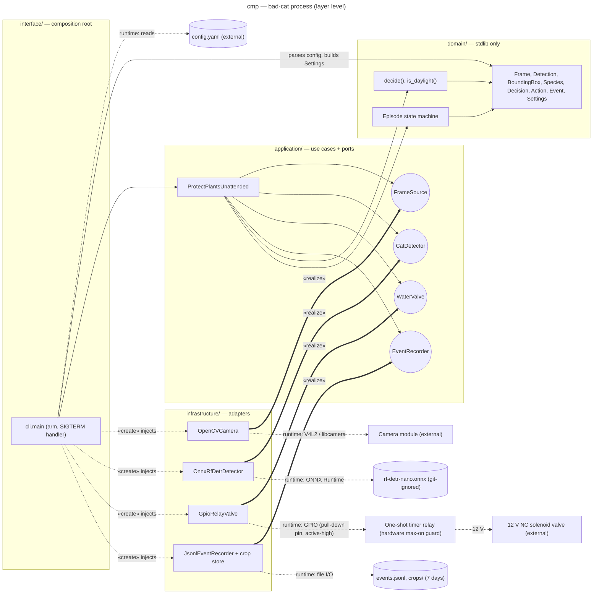

# Component diagram — cat-detection — Clean Architecture layers and ports

How the single Python process on the Raspberry Pi is split into layers, and which port each
adapter realises.

> **Feature**: issue #1 — [requirements](../../specs/cat-detection-requirements.md)
> **Related ADRs**: ADR-0001, ADR-0002, ADR-0003, ADR-0004, ADR-0005
> **Realises**: UC1 to UC5 · **See also**: `01-use-case.md`, `02-sequence-deter-cat.md`

## Context

It does not show runtime order (`SEQ-deter-cat`) nor the hardware wiring (deployment diagram, to
be added).

## Diagram

## Ports

| Port | Contract | v1 adapter | Requirement |
| --- | --- | --- | --- |
| `FrameSource` | `frames() -> Iterator[Frame]` yields the newest frame only (one-frame buffer), with monotonic `timestamp`, wall-clock `captured_at`, `brightness` and `image` (opaque `object` to the core, read only by adapters); `close()` | `OpenCVCamera` | REQ-1, REQ-4, REQ-7 |
| `CatDetector` | `detect(frame, min_confidence) -> list[Detection]` returns every `cat` and `person` box with confidence ≥ `min_confidence`; the use case passes `person_threshold`; no floor of its own | `OnnxRfDetrDetector` | REQ-1, REQ-3, NFR-1 |
| `WaterValve` | `pulse(seconds) -> None` opens, waits, closes in `try/finally`; refuses `seconds` ≥ relay cap | `GpioRelayValve` (closed on init) | REQ-4, NFR-5 |
| `EventRecorder` | `record(event: Event)` writes one line, `save_crop(frame, box)`, `heartbeat()`; the use case decides what to record | `JsonlEventRecorder` (purges log and crops older than 7 days) | REQ-5, REQ-6, REQ-7, NFR-4 |

## Notes

- `Settings` validates REQ-9 in `__post_init__` (domain), so an invalid `Settings` cannot exist;
  `cli.main` only parses `config.yaml` and builds it. A config error exits before arming.
- Dependency rule: every arrow points inwards. `domain/` imports the standard library only;
  `application/` imports `domain/` and the standard library (`typing.Protocol`) (NFR-2). Heavy
  libraries live in optional extras `vision` and `hardware` (ADR-0001).
- `decide()`, `is_daylight()` and the episode state machine are pure domain policy with no port:
  the veto (ADR-0004), the daylight rule (REQ-1) and the adaptive jet (REQ-4) are unit-tested with
  fake frames, no hardware.
- No clock port: every timing is computed from `Frame.timestamp`. If the camera stalls, no frame
  arrives, so the heartbeat stops (UC1 ext. *a).
- Valve fail-closed (NFR-5) has four layers: NC valve (power loss); a GPIO pin with a default
  pull-down driving an active-high relay input, so the coil is off whenever the pin is undriven
  (boot, exit); `pulse()` with `try/finally` plus a SIGTERM handler (exceptions, service stop);
  a one-shot timer relay cutting the coil after 3 s (hang, SIGKILL).
- NFR-4 invariant: `save_crop` is called only on `FIRE`, which implies no person, and stores only
  the cat box. Unit-tested.
- Pause (REQ-8, UC2) in v1 means stopping the service (`systemctl stop`); tuning (UC5) means
  editing `config.yaml` and restarting. UC3 and UC4 read `events.jsonl` and `crops/` over SSH in v1;
  the LAN review page (read-only, LAN-bound, authenticated) is a v2 interface adapter.
- `EventRecorder` is kept as one port: one client, one adapter; splitting it would be ceremony.
- Swapping RF-DETR for YOLOX-Nano (ADR-0002 fallback) or the sprayer for mains water (ADR-0003)
  is a new adapter only.
