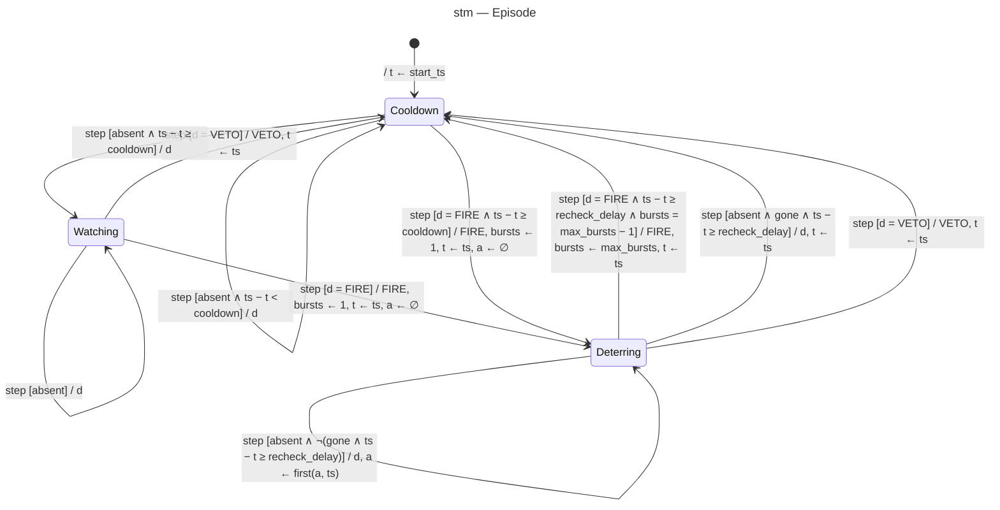

# State machine diagram — cat-detection — episode (adaptive jet)

The domain `Episode` turns each frame's decision into an action so that bursts follow REQ-4 and
any person holds off firing.

> **Feature**: issue #1 — [requirements](../../specs/cat-detection-requirements.md)
> **Related ADRs**: ADR-0004
> **Realises**: UC1 steps 4–5, ext. 3a, 5a, 5b · **See also**: `02-sequence-deter-cat.md`

## Context

The only trigger is `step(d, ts)` from `SEQ-deter-cat`: `d` is the decision of `decide()`, `ts`
the frame's monotonic timestamp (wall-clock time is for the log only). `t` is the time of the last
burst, or the start of the current cooldown; `a` is the time the cat was first missing (`∅` while it is
seen). `←` is assignment; `a ← first(a, ts)` keeps `a` if set, else takes `ts`. Parameters come from `Settings` (validated at start, REQ-9):
`recheck_delay` (5 s, > 0), `max_bursts` (3, ≥ 2), `absence_grace` (1 s, > 0), `cooldown` (60 s,
≥ 10 s veto hold-off floor). `start_ts` is the first frame's timestamp, passed when the use case
builds `Episode`: every (re)start, including a systemd restart or re-arming after a pause, begins
with a full hold-off, which also gives the gardener time to walk away.
`absent` means `d ∈ {ABSTAIN, IGNORE}`; `gone` means `a ≠ ∅ ∧ ts − a ≥ absence_grace`.

## Diagram

## Notes

- The initial transition enters `Cooldown`, not `Watching`, so a restart during a veto hold-off
  never clears it (the episode state lives in memory only).

- Safety: only four transitions output `FIRE`, each requires `d = FIRE` (no person at or above
  `person_threshold`, ADR-0004). A `VETO` in any state starts or restarts a full `cooldown`, so a
  person missed for a single frame never triggers a jet (UC1 ext. 3a, 5b).
- The loops on `Deterring` and `Cooldown` are **internal transitions** (no exit/entry): Mermaid
  cannot draw them, and `t` is assigned only in the effects shown, so a loop never resets a timer
  by accident.
- Absence grace (owner, 2026-10-28, MCDA 475 vs 430): one missed cat detection never ends an
  episode; the cat counts as gone only after `absence_grace` of continuous absence. An absent frame
  never fires (`a ← first(a, ts)` keeps the first missing time).
- Invariant in `Deterring`: 1 ≤ `bursts` ≤ `max_bursts` − 1 (guaranteed by `max_bursts` ≥ 2), so
  the two burst guards are exhaustive.
- `t ← ts` is set when the burst starts (before `pulse`), so the 5 s recheck delay counts from
  the start of the burst.
- The last burst goes straight to `Cooldown`, so the pause after burst `max_bursts` is exactly
  `cooldown`.
- Every transition is a unit test (state-transition testing): guards are pure comparisons on
  timestamps, no clock needed.
