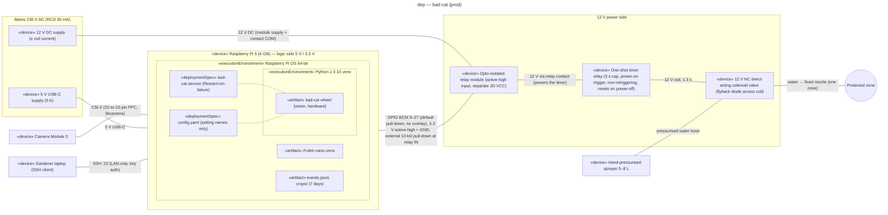

# Deployment diagram — cat-detection — garden device (prod)

Where the bad-cat process runs and how the camera, the valve guard chain, the sprayer, the power
supplies and the gardener's SSH access are physically connected.

> **Feature**: issue #5 — [requirements](../../specs/cat-detection-requirements.md)
> **Related ADRs**: ADR-0001, ADR-0002, ADR-0003, ADR-0004, ADR-0005
> **Realises**: UC1 to UC5, NFR-1, NFR-4, NFR-5 · **See also**: `03-component.md`

## Context

v1 has a single environment, `prod`: one device in the garden protecting one zone through one
fixed nozzle (owner decisions of 2026-10-30: Raspberry Pi 5 4 GB + Camera Module 3, MCDA 425/500;
one zone, extensible, MCDA 445/500). Development runs the core tests on a laptop without
hardware (NFR-6) and needs no diagram. No address, host name or credential appears here.

## Diagram

## Artifacts and components

| Element | «manifest» / used by (`03-component.md`) | Notes |
| --- | --- | --- |
| `bad-cat` wheel | «manifest» every layer: `interface/`, `application/`, `domain/`, `infrastructure/` | One process (ADR-0001); extras `vision` (OpenCV, ONNX Runtime) and `hardware` (GPIO) installed on the Pi only |
| `bad-cat.service` («deploymentSpec») | starts `cli.main` | `Restart=on-failure`; `systemctl stop` sends SIGTERM (pause, REQ-8); a restart begins in cooldown (`05-state-episode.md`) |
| `config.yaml` («deploymentSpec») | read by `cli.main` to build `Settings` | Validated at start (REQ-9); edited over SSH, then restart (UC5) |
| `rf-detr-nano.onnx` | loaded by `OnnxRfDetrDetector` | Git-ignored; copied to the device at install (ADR-0002) |
| `events.jsonl`, `crops/` | written by `JsonlEventRecorder` | On the device only, purged after 7 days (ADR-0005, NFR-4) |

Faults go to stderr, which systemd hands to journald (OS); the gardener reads them with
`journalctl` over SSH (UC4), and reads the log and crops the same way (UC3).

## Fail-closed layers (NFR-5, ADR-0003)

| Layer | Node | Failure it covers |
| --- | --- | --- |
| Normally closed valve | 12 V NC solenoid valve | Power loss on the 12 V side |
| Pull-down (Pi pin + external at relay input) + active-high relay | GPIO pin (edge Pi → relay), relay module | Input undriven: boot, Pi reboot, clean exit (line released), 5 V supply loss, broken signal wire |
| `pulse()` in `try/finally` + SIGTERM handler | `bad-cat` process | Exception, service stop mid-burst |
| One-shot timer relay | Timer relay, powered by the relay contact, output in series with the coil | Hang, SIGKILL (including after systemd's stop timeout), welded relay contact |

## Notes

- Isolation boundary: the opto-isolated relay module's input is referenced to the Pi ground, its
  coil and contacts to the 12 V supply (separate JD-VCC), so the two sides share no conductor and
  12 V never reaches a GPIO pin.
- Pin choice: only BCM 9–27 default to pull-down at reset (BCM 0–8 pull up); the chosen pin carries
  no overlay or `gpio=` directive in `config.txt`.
- Outdoor mains: both supplies on an RCD-protected (30 mA) outlet, in an IP-rated enclosure,
  above and away from the water path.
- Valve: direct-acting (zero minimum pressure), because a hand sprayer gives about 3 bar or less
  and loses pressure as it empties; a pilot-operated valve may not open on a 0.5 s pulse.
- Camera: on the Pi 5, Camera Module 3 is reached through libcamera; `OpenCVCamera` may need
  Picamera2 (apt package, venv with system site packages) or a libcamera source (risk in the spec).
- Ingress: SSH on the LAN is the only way in; no port is exposed to the internet. Images are
  stored on the device only; crops reach the laptop over SSH on the LAN and never leave the local
  network (NFR-4). The LAN review page (UC3) is a v2 interface adapter on this node.
- Performance: NFR-1 (≥ 2 frames/s) is measured on this exact node; RF-DETR Nano runs on the
  Pi 5 CPU through ONNX Runtime, YOLOX-Nano as fallback (ADR-0002).
- Veto (ADR-0004): no veto path exists in hardware; a blocking 0.5 s burst is the residual
  exposure, capped at 3 s by the timer relay in the worst case.
- Multi-zone extension: one more zone means one more GPIO pin, relay, timer relay, valve and
  nozzle behind the `WaterValve` port; the camera and the process stay single.
- Boot test (NFR-5): the valve stays shut from power-on until the service arms, with the Pi
  unpowered and 12 V live, and with the signal wire disconnected.
